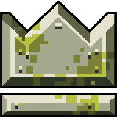

<!-- ============================================================
  README 初稿（新仓库用）· 设计参考：T8RIN/ImageToolbox
  需要替换的占位（共 4 处，均已用注释标出）：
   1. OWNER/REPO      → 你的 GitHub 用户名 / 仓库名
   2. 图标图片路径     → 想换就换（当前引用工程内 options/mac/icon512.png）
   3. Download 链接    → 你的网盘分享页 / itch 页面
   4. Screenshots      → 放 2-3 张截图（建议新建 screenshots/ 目录）
  另外：AI 辅助开发的说明由你自己按需补充（建议放文末小字）。
============================================================ -->

<div align="center">



<h1>NuclearThroneMobile:Epsilon</h1>

<p>
  <b>Open-source rebuild &amp; Android port of Nuclear Throne</b><br/>
  <sub>Font Pipeline redesign · 60 FPS support · Fix &amp; Improve · Resourcepacks fixed</sub>
</p>

<!-- 徽章：1、2 处为动态徽章，需把 OWNER/REPO 替换为你的仓库全名 -->
[](./LICENSE)
[](#-building)
[](https://gamemaker.io/)
[](../../releases)
[](https://github.com/toarch7/nt-recreated-public)
[](https://toncho.itch.io/nuclear-throne-mobile/)

</div>

---

## 📖 About

A source-available **rebuild and Android port** of *Nuclear Throne*, the game by [Vlambeer](https://vlambeer.com/).
Forked from 

<div align="center">

[$$toarch7/nt-recreated-public$$](https://github.com/toarch7/nt-recreated-public) 

</div>

Based on a decompiled source of **Update #19 (u19)** and largely rewritten from scratch to match the contents of the latest version.

Built with **GameMaker** — so is the original game.

> [!WARNING]
> **This repository contains no assets from the original game.**
> To make it buildable, you must extract all assets from **your own copy** of Nuclear Throne.
> See [Building](#-building) below.

> [!NOTE]
> This is **not an official build** and is **not affiliated with Vlambeer or the NTM authors**.
> The original *Nuclear Throne Mobile* by **toncho_** lives at [toncho.itch.io/nuclear-throne-mobile](https://toncho.itch.io/nuclear-throne-mobile/).

---

## ✨ Features

- 🎮 **Play on Android & Desktop** — touch controls out of the box, plus gamepad and keyboard+mouse support
- ⚡ **60 FPS support** — with frame-rate-safe gameplay fixes across weapons, enemies, and effects
- 💾 **Save & Continue** — resume your runs without losing progress
- 🏆 **Achievements** — re-implemented Steam achievements system
- 🌍 **Localization** — community-translated; multiple languages supported
- 📦 **Resourcepacks** — easy customization with detailed option settings
- 🕹️ **Quality-of-life options** — extensive video / control / game settings
- 💰 **Free forever** — no ads, no in-app purchases, no monetization

---

## 📥 Download

<!-- 替换为你的分发页（网盘分享页 / itch 页面）。构建产物不放在本仓库。 -->

> [!IMPORTANT]
> The releases from this repository do not include any physical packages!

- Due to the legal issues, if you want to experience this version, you will need to extract all the assets from your own copy of Nuclear Throne and **build it**. If you find it troublesome, you can also download the installation package from **the cloud storage**.
- The cloud storage is where I store my **personal** files; it has nothing to do with this repository itself. This repo **doesn't** come with any assets from the original game.


<div align="center">

<a href="https://drive.google.com/drive/folders/1f09tGm5UQgpeJRdzlvDUwUycaFQKZUEc?usp=drive_link">


</a>

</div>


---

## 🔨 Building

**Requirements**

| Dependency | Notes |
|---|---|
| [GameMaker](https://gamemaker.io/) | IDE + runtime (license for Android/Desktop export) |
| [Node.js](https://nodejs.org/) | v20.0+ |
| Nuclear Throne (update 100+) | **your own copy** — assets are extracted from it |

**Resource extraction** — from your own game installation:

```shell
# Windows
.\project-setup-windows.bat

# Linux
bash ./project-setup-linux.sh
```

or manually:

```shell
cd node-scripts
npm ci
npm run regen
```

The scripts extract all assets from your copy of the game and copy them into the GameMaker project, making it compileable.
By default they look in your Steam library; use `-- --game-path="/your/path/here/"` to override.

> [!NOTE]
> Whenever new base-game assets are introduced, run `npm run regen-ignores` — this updates the ignore files so raw assets are never committed.

Then open the project in GameMaker and build for your target platform (Android / Windows / Ubuntu / macOS).

---

## 🖼️ Screenshots

<div align="center">
  
  
  
</div>

---

## 🙏 Credits

- **[toncho_](https://toncho.itch.io/nuclear-throne-mobile/)** — original *Nuclear Throne Mobile* project
- **[Vlambeer](https://vlambeer.com/)** — *Nuclear Throne*, the game this is built upon
- **All contributors** — see the [contributors](../../graphs/contributors) page

---

## ⚖️ License

This project's code is licensed under the **[GNU General Public License v3.0](./LICENSE)**.

*Nuclear Throne* is created and owned by **Vlambeer**. All rights reserved.
This is a non-commercial fan project and is **not affiliated with or endorsed by Vlambeer**.
No assets from the original game are included in this repository.

<!-- 完成后可在文末自行补充（小字，例如）：
<p align="center"><sub>Developed with AI-assisted workflows.</sub></p>
-->
